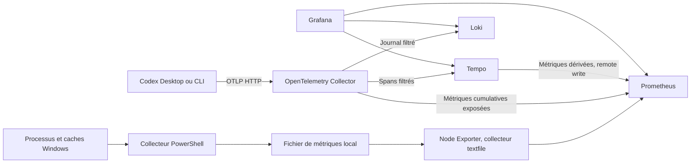

# Architecture locale

| Service | Adresse hôte | Adresse dans Compose | Pourquoi ce composant |
| --- | --- | --- | --- |
| Grafana | `http://127.0.0.1:3000` | `grafana:3000` | Ouvre les tableaux et Explore, avec des sources de données provisionnées. |
| OpenTelemetry Collector | `http://127.0.0.1:4318` | `otel-collector:4318` | Réception commune des trois signaux, traitement, filtrage et routage. |
| Prometheus | Réseau Compose | `prometheus:9090` | Relevés, séries temporelles, requêtes PromQL et alertes locales. |
| Loki | Réseau Compose | `loki:3100` | Journaux structurés filtrés recherchables dans Explore. |
| Tempo | Réseau Compose | `tempo:3200`, OTLP gRPC sur `tempo:4317` | Chronologie par trace, événements associés et métriques dérivées des spans. |
| Node Exporter | Réseau Compose | `textfile-exporter:9100` | Adapte le fichier de métriques Windows au protocole de relevé Prometheus. Seul le collecteur textfile est activé. |
| Exposition de métriques OTLP | Réseau Compose | `otel-collector:8889/metrics` | Point de relevé des métriques applicatives converties en cumulatif. |
| Métriques internes du Collector | Réseau Compose | `otel-collector:8888/metrics` | Point de relevé pour diagnostiquer la réception, le traitement et l’export. |

Les services employant les mêmes ports sur un autre poste restent accessibles seulement là où leur Compose les publie. Les noms de service Docker sont résolus sur le réseau Compose. Les deux ports hôte utilisent une liaison IPv4 à `127.0.0.1`. L’ingestion OTLP locale est conçue pour un poste de confiance. Grafana requiert une authentification. [Réseau Docker Compose](https://docs.docker.com/compose/how-tos/networking/)

## Cadences et conservation

| Données | Cadence ou conservation | Emplacement |
| --- | --- | --- |
| Processus Windows | Relevé du script et scrape toutes les 2 s par défaut | `%LOCALAPPDATA%\CodexObservability\metrics\host.prom`, puis Prometheus |
| Caches Windows | Nouveau scan toutes les 5 min par défaut | Mesures de taille dans le même fichier, puis Prometheus |
| Codex et services | Scrape Prometheus toutes les 10 s par défaut. L’émission OTLP suit la cadence de Codex. | Expositions ou backends locaux |
| Prometheus | Jusqu’à 15 jours et 3 Go de blocs TSDB. La première limite atteinte s’applique. Le WAL et d’autres fichiers utilisent aussi de l’espace. | Volume `prometheus-data` |
| Loki et Tempo | 168 h, soit 7 jours. La compaction retire les données selon son propre cycle. | Volumes `loki-data`, `tempo-data` |
| Grafana | Conservation liée au volume | Volume `grafana-data` pour l’administration et les réglages |
| Journaux stdout/stderr des conteneurs | Rotation à 10 Mo, trois fichiers par service | Pilote Docker `json-file`, distinct de Loki |

Le collector conserve temporairement les états de conversion des métriques delta en cumulatif. Après une interruption ou une expiration, les nouvelles séries démarrent avec une nouvelle base. Prometheus peut continuer à servir l’historique de ses relevés selon sa rétention. [Modèle de données OpenTelemetry](https://opentelemetry.io/docs/specs/otel/metrics/data-model/) · [Stockage Prometheus](https://prometheus.io/docs/prometheus/latest/storage/) · [Rétention Loki](https://grafana.com/docs/loki/latest/operations/storage/retention/)

## Couverture

Le collecteur Windows repère les processus Codex, dont l’application empaquetée `OpenAI.Codex`, et suit leurs descendants visibles. Les droits de Windows, les processus très courts et la cadence de relevé bornent la couverture. Les PID peuvent être réutilisés par le système. Un PID partageant le même nom à deux moments différents peut désigner deux exécutions distinctes.

Le plan de données OTLP reflète les signaux émis par la version et le trajet d’exécution de Codex. Par exemple, une session WebSocket peut produire des séries différentes d’une session HTTP. Le calcul interne côté serveur, les quotas d’abonnement et les bases de facturation restent hors du périmètre du collecteur du poste. [Télémétrie Codex](https://learn.chatgpt.com/docs/config-file/config-advanced#observability-and-telemetry)
